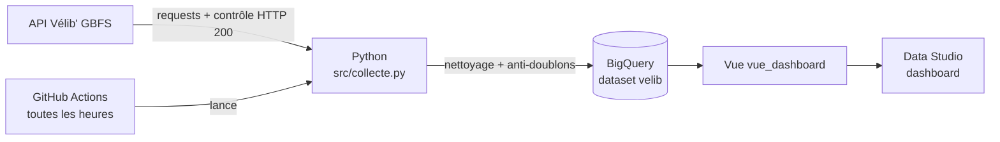

%%writefile README.md
# 🚲 VéloCité – De l'API au tableau de bord

Pipeline automatisé de collecte des disponibilités **Vélib' Métropole** : **API → Python → BigQuery → GitHub Actions → Data Studio**.

📊 **Dashboard :** COLLE_ICI_LE_LIEN_DU_DASHBOARD

---

## 1. Cas d'usage
**VéloCité** est un opérateur fictif de vélos en libre-service en Île-de-France. Son problème : des stations **vides** (impossible de prendre un vélo) ou **pleines** (impossible de le rendre).

**Question métier :** *quand et où les stations sont-elles vides ou pleines, pour mieux organiser le rééquilibrage des vélos et la maintenance ?*

**Pourquoi l'API Vélib' ?** Publique, gratuite, sans clé, au format standard GBFS, mise à jour en temps réel pour environ 1 500 stations. Deux flux complémentaires reliés par `station_id` :
- `station_information` : nom, position GPS, capacité, code station
- `station_status` : vélos disponibles (mécaniques / électriques), places libres, état

L'API ne donne que l'instant présent : la **collecte toutes les heures** construit l'historique nécessaire à l'analyse dans le temps (par heure) et par lieu (par zone).

## 2. Architecture



| Étape | Outil | Rôle |
|---|---|---|
| Collecte | Python (`requests`) | Appel des 2 flux de l'API, contrôle du code HTTP |
| Traitement | Python (`pandas`) | Nettoyage, jointure, indicateurs, clé anti-doublons |
| Stockage | BigQuery (`pandas-gbq`) | Tables `stations`, `disponibilites`, `journal_executions` |
| Automatisation | GitHub Actions | Lancement toutes les heures, connexion sans clé |
| Restitution | Data Studio | Dashboard connecté à la vue `vue_dashboard` |

## 3. Données

| Table / vue | Contenu | Mise à jour |
|---|---|---|
| `stations` | Infos fixes : `station_id`, nom, GPS, capacité, code station, `accepte_cb` | Remplacée à chaque collecte |
| `disponibilites` | Une photo de chaque station par heure : vélos (mécaniques / électriques), places libres, `taux_remplissage`, `station_vide`, `station_pleine`, `date_collecte` | Ajout avec anti-doublons |
| `journal_executions` | Une ligne par lancement : date, statut (OK / ERREUR), nombre de lignes, message | Ajout |
| `vue_dashboard` | Jointure des deux tables + zone (arrondissement), heure de Paris, places hors service | Vue (toujours à jour) |

## 4. Transformations et contrôles qualité

| Contrôle / transformation | Détail |
|---|---|
| Code HTTP | Tracé dans les logs ; toute réponse différente de 200 arrête la collecte |
| Colonnes en double ou vides | `numBikesAvailable`, `numDocksAvailable`, `station_opening_hours` supprimées |
| Colonne imbriquée | `num_bikes_available_types` → `nb_mecaniques` et `nb_electriques` |
| Types | `last_reported` (timestamp Unix) → date ; booléens ; nombres |
| Valeurs manquantes | `rental_methods` (625 manquants) → booléen `accepte_cb` |
| Valeurs aberrantes | Stations à capacité 0 ou non installées exclues |
| Doublons dans l'API | Contrôle sur `station_id` : 0 doublon |
| Doublons au fil des lancements | Clé unique `station_id` + heure de collecte, vérifiée dans BigQuery avant chaque envoi (`sql/00_controle_doublons.sql`) |

## 5. Installation

```bash
git clone https://github.com/suzy5670/velocite-velib.git
cd velocite-velib
pip install -r requirements.txt
```
Prérequis : un projet Google Cloud avec BigQuery et un dataset `velib`. Au premier lancement en local, `pandas-gbq` ouvre le navigateur pour se connecter avec un compte Google (aucune clé stockée).

## 6. Exécution

```bash
python src/collecte.py
```
Les traces sont écrites dans `logs/collecte.log` et dans la table `journal_executions`.
Le notebook `velib_propre.ipynb` détaille toute la démarche : exploration, nettoyage, script, SQL.

## 7. Automatisation
- **Outil :** GitHub Actions (`.github/workflows/collecte.yml`), lancement **toutes les heures à HH:05 (UTC)** + bouton de lancement manuel.
- **Connexion sans clé :** la création de clés JSON étant bloquée par une règle de sécurité Google Cloud, le workflow utilise la **fédération d'identité** (Workload Identity Federation). GitHub prouve son identité à Google, qui accorde un accès temporaire au compte de service. Une condition limite l'accès à ce seul dépôt. **Aucun secret n'est stocké sur GitHub.**
- **Traces :** logs visibles dans chaque exécution GitHub Actions + table `journal_executions`.
- **Anti-doublons :** une seule photo par station et par heure, même si le script est relancé.
- *Historique :* une première version utilisait le Planificateur de tâches Windows (`lancer_collecte.bat`), abandonnée car elle ne tournait pas quand le PC était éteint ou sur batterie.

## 8. Requêtes SQL (`sql/`)

| Fichier | Contenu |
|---|---|
| `00_controle_doublons.sql` | Contrôle qualité : aucun doublon |
| `01_stations_vides_maintenant.sql` | Stations vides à la dernière collecte (filtre, jointure, tri) |
| `02_situation_par_heure.sql` | % de stations vides / pleines par heure (agrégation) |
| `03_top10_stations_vides.sql` | Stations le plus souvent vides (jointure, agrégation, tri) |
| `04_kpi_reseau.sql` | Vélos disponibles et places hors service |
| `05_secteurs_plus_demandes.sql` | Départs estimés par zone (fonction `LAG`) |
| `06_vue_dashboard.sql` | Vue utilisée par le dashboard |
| `07_preuve_journal.sql` | Historique des exécutions automatiques |
| `08_preuve_photos_par_heure.sql` | Nombre de stations collectées par heure |

## 9. Dashboard
Lien : COLLE_ICI_LE_LIEN_DU_DASHBOARD

- **Vue d'ensemble :** 6 KPI (vélos disponibles, mécaniques, électriques, remplissage, % de stations vides et pleines), zone la plus critique, vélos par zone, vélos et stations vides selon l'heure, statut des stations, top 10 des zones les plus vides, stations vides en permanence. Filtres : période et zone, plus le filtrage croisé.
- **Synthèse :** conclusion et recommandations.

**Conclusion :** en moyenne 6,9 % des stations sont vides et 3,2 % pleines, avec des pics à 11 h et 18 h. Les zones les plus touchées sont Paris 20 et Paris 18 (quartiers en hauteur). Recommandation : rééquilibrer avant 9 h et 17 h, du centre vers les collines.

## 10. Preuves d'exécution

| Exécutions GitHub Actions | Logs d'une exécution |
|---|---|
|  |  |

| Journal dans BigQuery | Contrôle des doublons |
|---|---|
|  |  |


## 11. Limites et pistes d'amélioration
- L'API indique les vélos présents, pas les locations : les flux par zone sont **estimés**.
- Les vélos ne sont pas suivis individuellement (impossible de mesurer les vélos perdus).
- Une dizaine de stations fermées à la location (`is_renting = 0`) augmentent légèrement le taux de stations vides → à exclure du calcul.
- Bac à sable BigQuery : tables conservées 60 jours, pas de requêtes `INSERT` / `MERGE` (anti-doublons géré en Python).
- Pistes : collecte sur plusieurs semaines (semaine / week-end), croisement avec la météo, alertes automatiques.

## 12. Structure du dépôt
```
├── .github/workflows/collecte.yml   # automatisation horaire
├── src/collecte.py                  # script de collecte
├── sql/                             # requêtes SQL
├── preuves/                         # captures d'exécution
├── velib_propre.ipynb               # notebook de la démarche complète
├── requirements.txt
└── .gitignore
```
